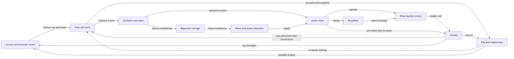

> Archived initial experiment. Superseded by the colour-only construction direction on 24 October 2026. These economy and progression mechanics are no longer active.

# Block City: design experiment

## The question

Can choosing where to fit a room, while preserving its entrance and paying for its service connections, create a satisfying short city-building puzzle before architecture and decoration are added?

The proposed identity is a calm, turn-based vertical neighbourhood builder. Each move changes three things: occupied space, future access, and the utility budget. There is no falling timer. Space commits a predicted landing. A building is an enduring part of the city, so a clever fit matters beyond the moment of placement.

The new brief authorizes this experiment's modern room functions, turn-based placement and Space-to-drop behavior. It does not rewrite the existing settlement's continuous-play controls, historical materials or economy. Shared UI point sizes, hidden instruction panel and hidden persistent objectives still apply.

## Core loop and purpose

**Choose use → fit shape → preserve door → connect → activate → serve residents → earn room for expansion.**

The primary success condition combines occupied homes and functioning services. Money is a constraint and an expansion resource; population alone would encourage identical stacks, money alone could encourage farming cheap pieces, and connection count alone would reward unnecessary wiring. The combined condition makes all three matter. Internal targets are explicitly prototype tuning.

| Stage | Plot | Above / below | Internal requirement | Purchase |
| --- | --- | --- | --- | --- |
| Pocket block | 3×3 | 9 / 3 floors | 3 active homes; shop and laundry capacity for 12; active basement transformer | 12 credits |
| Neighbouring lot | 3×4 | 9 / 3 floors | 4 active homes; shop, laundry and school capacity for 16; transformer | 16 credits |
| Corner district | 4×4 | 10 / 4 floors | 8 active homes; those services cover 32; transformer | Final test lot |

The first two purchases extend the same block so previous choices remain relevant. Expansion preserves street-facing entrances as explicit corridors where the street becomes buildable land. A later block-by-block campaign should archive completed blocks as persistent neighbourhoods; the current demo records expansion history but has only one playable plot.

## Entity/action map

| Entity | Verbs | Inputs / dependencies | Consequence elsewhere |
| --- | --- | --- | --- |
| Room card | Preview, rotate, tip, hold, change use, refit | Shape library, current free volume, previous shape use | Changes placement options, demand and future deck needs |
| Placed room | Drop/raise, connect, switch, inspect, undo | Bounds, collision clearance, direct support or brace | Provides support, blocks volume and approaches, consumes power |
| Door | Face, preserve approach, connect | Authored wall cell/normal; reachable empty adjacent cell | Gates occupation, service operation and transformer access |
| Corridor/stair | Purchase, share, reserve | Empty route; supported interior floor or external scaffold | Consumes usable volume, joins door to street, constrains later drops |
| Wire | Purchase, trace by selection, preserve | Separate explicit path to the street riser | Supplies electrical allocation; never grants walking access |
| Transformer | Install, switch off/on | Accessed and wired basement Storage; credits | Adds power, enables more surface rooms, competes for underground space |
| Home/residents | Occupy, vacate when disabled | Door access, enabled state, electricity | Creates service demand and potential rent; counts for lot readiness |
| Shop/laundry/school | Operate, switch, join matching type | Access, electricity, enough room to place | Covers population; enables rent and expansion |
| Matching group | Join by face contact, split by disabling | Same type; all members active | One-time activation grant increases by up to two credits |
| Credits | Spend, grant once, earn rent on next placement | Active rooms and service coverage | Funds construction, connections, forecast and land |
| Plot | Fill, extend | Active homes, coverage, transformer, credits | Adds volume, increases demand, changes feasible deck offers |

Undo restores a complete state snapshot. It is a recovery mechanic, not demolition: the player cannot remove a foundation underneath an established structure while keeping the rest floating.

## Spatial contract

Each authored shape contains exactly four face-connected cubes. Coordinates are `[x, height, depth]`. Yaw rotates around height. Tip rotates around the original door's facing axis, so the door stays on a wall. Sixteen yaw/tip combinations are allowed; this is deliberately not unrestricted free rotation. Several orientations duplicate each other.

Above ground, the shape starts just inside the regulation ceiling and descends until its next step would collide. It never passes through a roof into a cavity. Full floors remain in place, so the lowest reachable placement rises naturally without a special disappearing-row rule. Irregular holes can become permanently inaccessible from above; this is a planning consequence, not a hidden fill operation.

Only the bottom-most cell in each occupied column needs an external support check. It must have ground or an existing cell underneath, or a diagonal beam to supporting material one horizontal step away. A directly anchored column inside the same new room is also valid beam material. At least one column must have direct support. A beam cannot anchor another beam: two-cell overhangs fail. This is a binary support rule, not structural load simulation. No collapse or weight capacity is implied.

Basements mirror the algorithm. A shape starts above bedrock, moves up toward the ground underside, and stops before collision. The surface is its initial ceiling; existing basement cells support deeper attachments. Bedrock bounds the volume. The view switches to a true cutaway rather than making surface rooms unselectably transparent.

The surrounding road provides direct ground access only if the door's adjacent cell lies on the road ring. Upper doors require a purchased route. Interior corridors require an existing supporting floor; perimeter paths use a simplified external scaffold. Vertical travel is allowed only at the northwest staircase. This intentionally reduces early path authoring friction while retaining door placement and volume costs. It is not a full freeform staircase tool.

Electricity uses independent saved paths through empty space and the corner riser. It does not test floor support. The current model has one electrical budget per block: a street supply plus transformer additions. Priority is stable placement order; switching an older room off releases its allocation to a later one. Cable length, voltage conversion, circuit separation and overload damage are not simulated. These simplifications should be tested before building an ONI-sized network system.

## Economy and service balance

| Value | Current tuning | Purpose |
| --- | --- | --- |
| Starting credits | 64 | Allows mistakes and early infrastructure |
| Place any four-cell room | 4 | Stable geometric comparison across shapes |
| Access / wire | 2 / 2 per room | Two distinct investments; path length is free in this test |
| First activation | 5, plus 0–2 matching-group bonus | Rewards making placed rooms work; paid only once |
| Street supply | 6 | Makes the first transformer useful quickly |
| Transformer | Costs 6; adds 10 power | Links scarce basement volume to surface growth |
| Loads: home / shop / laundry / school / storage | 1 / 2 / 3 / 2 / 0 | Lets switch-off decisions redistribute real capacity |
| Home population | 4 per active home | A room-level abstraction, not individual agents |
| Shop / laundry / school capacity | 12 / 12 / 24 residents per active room | Scales service investment with neighbourhood size |
| Rent | 1 per 12 fully served residents, capped at 3 per successful placement | Rewards operating services without a wait-for-money exploit |
| Forecast upgrade | 8 | Exchanges current construction budget for information |
| Expansion grant | 20 | Keeps later stages funded while preserving accumulated choices |

Served population is the minimum of active home population and each required service's total capacity. Schools become required in stage two. Rent is calculated before the new room is added. A failed placement generates no rent, and toggling a room never repeats its activation grant. Merely touching a service does not connect a home: services use the shared street-connected neighbourhood. Per-house service range and real delivery routes are future work.

Matching schools currently improve the one-time joining reward, not their model tier or recurring efficiency. This is an intentionally small first joining rule. If playtests show that placement does not change enough when rooms match, the next candidate is a shared-service capacity bonus that saves a whole service placement; it should replace, not accumulate alongside, decorative upgrade tiers.

## Director and fairness

There is no independent random draw. The director enumerates supported landings and checks access after temporarily inserting the candidate into occupancy. It prefers shapes with connectable placements, lower landings, positive configured weight, fewer previous appearances and variety relative to the last queued shape. Room use fills missing service capacity before defaulting to homes. Placed and queued rooms, including the held card, count toward offers. The player can change the current surface room's function freely within the unlocked uses.

The initial home is fixed; the same opening map and actions reproduce the same queue. Current plus one future card are shown. Purchasing the forecast reveals the second stored future card; it does not alter the deck. The queue stays fixed after it is advertised. The director cannot anticipate every player placement; after an intervening move makes a card unusable, explicit Refit can replace its shape for free. If no shape has a connectable placement, Refit reports that Undo is needed.

`weight` is a preference score, not a literal percentage or probability. In the verified 20-placement run: Square 3, Elbow 4, Corner 2, Tee 3, Step 2, Bridge 3, Zigzag 3. This is one deterministic trajectory, not a distribution estimate. A future deck-builder would let players change their repertoire and trade-offs between blocks. This version is a directed supply queue with hold and forecast, not a full deck-builder.

## Dead ends and interventions

| Risk | Present response | What remains to validate |
| --- | --- | --- |
| Door ends inside another building | Route fails; red frame, cutaway, inspect and full undo | Whether players understand the door before committing |
| Need an L but receive unusable pieces | Enumerate real fits; hold; explicit emergency refit | Fewer than 10% of moves should feel forced; measure rather than assume |
| Future card becomes impossible | Preserve promise, allow explicit refit only when needed | Clear enough without a tutorial paragraph? |
| Budget trap | 64 starting credits, activation grants, rent, undo, restart | New-player error tolerance; solver success is insufficient |
| Repeat switch or undo to farm money | Rewarded flag persists; undo restores all money and queue state | Covered by rules tests |
| Electrical shortage looks like a bug | Teal power lamp, selected capacity, stable priority, switch-off | Whether a player discovers the basement transformer |
| Connections become repetitive clicks | Automated route construction | Test combined connection purchase later if both graphs stop producing decisions |
| Unlimited external scaffolds trivialize access | Internal route volume and one fixed riser still constrain entrances | Most serious balance simplification: compare limited scaffold reach/route length later |
| Safe tower strategy dominates | Different shapes, services and finite ceiling | Human layout diversity; no tested claim that the strategy space is deep yet |
| Matching room bonus is negligible | Small activation reward | Replace with a capacity-saving upgrade if players ignore matching |
| A larger world magnifies the same puzzle | Only three bounded test stages | New topology must change decisions, not just increase dimensions |
| Goal is invisible | No goal UI added under existing project instructions | Agree on a compact visual district request before an unassisted public demo |
| School or storage becomes a disconnected feature | School limits served population; storage hosts power capacity | Storage inventory and parking are intentionally absent instead of fake systems |

## Scope after this experiment

First validate spatial choices with the boxes. Then test **one** constraint at a time: longer corridor cost, alternate stair location, or a service cluster upgrade. Keep the same opening seed for A/B comparison. Do not add decoration to hide a weak loop.

If the loop earns a second session, add procedural facades as presentation of saved room geometry. A type, deterministic instance seed, occupied cells, entrance normal and utility mounts should generate a distinct shell without changing collision or connectivity. Render roof and side variants from exposure, not random geometry that invalidates doors. Interiors become a selection cutaway, never a requirement to furnish every cell before the planning puzzle works.

Half-cell floors come later with explicit connector endpoints and doubled integer coordinates. Room → building → quarter scale changes require different aggregation contracts: inhabitants and utility demand must survive the transition, while a larger piece exposes a limited set of street and utility ports. Do not simply scale every mesh or reset all progress. Parking, fossil exclusions, non-flat starting plots, freeform networks, archived playable blocks and town-scale logistics remain proposals, not shipped features.
