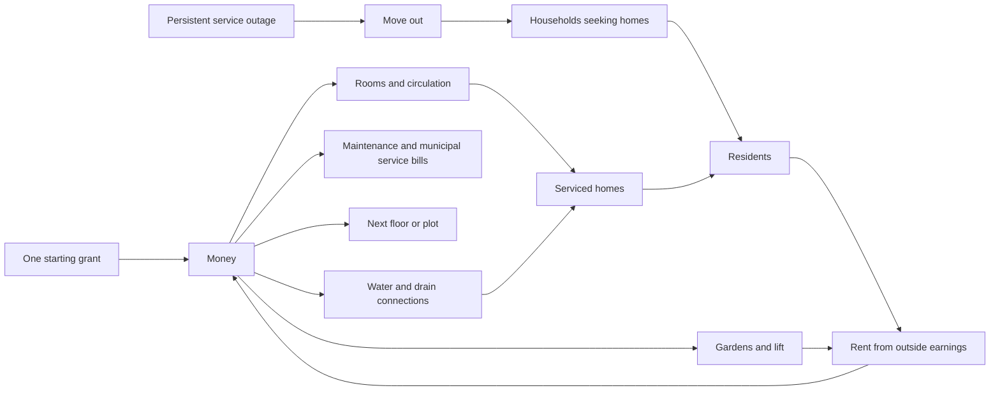

> Status after the 25 October playtest: exploratory research, not the confirmed game direction. The user chose the construction demo and rejected exploded views, manual month advancement, and Builder/Creative/Sprint choices. The lab is removed from the construction menu; its accounting model is retained for development comparison. Concrete stairs and the toilet silhouette remain useful visual references. See DESIGN.md for the current implementation.

# A small economy for rooms that become a town

Design proposal and isolated playable experiment, 25 October 2026. These are tuning hypotheses, not a validated economy or evidence of player retention. The existing construction demo remains the place to test shapes, halls, doors and electricity. Open its Escape menu → **Economy Lab** to test the new loop without touching that save.

## The central decision

Use **money and residents**, with no third inventory initially. Water, sewage, electricity and circulation are connections and throughput constraints. They do not need four more stockpiles or four more top-bar counters.

The player is choosing **what space becomes, how people reach it, and how services reach it**. Money makes the order of those decisions matter. Residents make functioning space visibly different from empty construction. More resource types would not automatically deepen this decision.

Residents are people occupying homes, not a currency spent on buildings. A later workplace reserves their work time; it does not consume or duplicate them. Capacity, monthly surplus, floor number and service condition are derived information, not additional resources.

## Taps, converters and sinks

| Element | Enters the economy | Conversion | Leaves the economy |
| --- | --- | --- | --- |
| Money | One starting grant; rent paid from residents' off-site earnings; later outside customers of local workplaces | Construction turns money into usable space; pipe work turns money into connected capacity; gardens and lifts turn capital into amenity and modest rent improvements | Construction, pipes, floor shells, capacity upgrades, lift, recurring service and maintenance bills; later new plots and renovation work |
| Residents | A finite local pool of households moves into accessible, powered, supplied and drained homes | A serviced home supports two residents; residents produce rent each simulation month; later staffed rooms produce income or services | Departure after a sustained service failure; voluntary relocation when a home is removed. No death spiral is required for this game |

Water enters through a blue municipal supply connection. Use creates wastewater, which must leave through a separate drain leading to the road manhole. This is a service lifecycle rather than two collectible commodities. Electricity enables appliances and lifts; circulation admits residents. These gates should share the same room-status language.

Avoid a disconnected industry chain: no wood → planks → furniture merely to justify three resources. If a workshop is introduced later, it must earn outside income or solve a real local need using residents' work time, floor area, power and existing sanitation. Do not also count the same local wage transfer as newly created wealth.

## Balance means affordable decisions, not zero surplus

A town with income exactly equal to costs cannot build its next floor. Target a stable operating surplus and a recoverable construction budget. Spend time arranging a room for free; advance economic time deliberately. A player should never lose money because they are admiring the view or reading a menu.

The lab uses explicit monthly turns. Its sun icon advances one month. Connecting or reconnecting does not pay rewards. Only a month with genuinely serviced occupancy produces rent. Unoccupied rooms create no monthly debt, but their construction cost still ties up money.

Prototype guardrails:

- The starting grant buys the first home and both utility connections with a large reserve.
- A single household must remain solvent, even with a long route. Municipal pipe surcharges have a visible, configurable per-resident ceiling; basic household viability is subsidized, not secretly achieved by clamping the final balance.
- A missing connection stops rent for affected homes. Existing residents get two monthly turns of grace before departure. Empty homes simply wait for service.
- Full refunds and atomic undo make this lab forgiving. Removal can refund rooms, the top floor and its contents, the lift, or the street upgrade; early infrastructure purchases cannot permanently trap the startup budget. Money, residents, elapsed months and income roll back together. A build/remove cycle cannot create cash.
- Household demand is finite and shared pipe capacity is real. Idle money cannot create unlimited residents or floor space.
- Financially viable does not mean every layout produces the same income. Garden-heavy layouts trade density for appearance and local amenity; they must still have a positive margin.

### Current tuning

All values live in `data/block_city/economy_lab.json`. One lab cell is a room-sized design unit, not a measured real-world plumbing unit.

| Item | Value |
| --- | ---: |
| Starting cash | 150 |
| Home / garden | 24 / 12 |
| Additional supported floor, corridor, stair and bathroom shell | 32 |
| Street capacity expansion, 16 → 24 residents | 24 |
| Lift | 36 |
| Residents per home / bathroom capacity per floor | 2 / 8 |
| Rent per resident per month | 4 |
| Occupied-home upkeep | 2 per month |
| Basic services | 1 per resident per month |
| Local garden rent bonus | 0.5 per resident, non-stacking |
| Lift bonus | 0.5 per resident above ground; 3 monthly upkeep while serving upper-floor residents |
| Each independent water/drain link | 2 + 2 × length + 1.5 × bends |
| Active pipe maintenance | 0.2 × used length, capped at 0.75 per served resident |

Each floor has a shared corridor, stairs and one wet room. The remaining five positions can become homes or gardens. Four homes exhaust that floor's eight-person bathroom capacity; filling every position with homes is not automatically best. Gardens only improve nearby homes, within two grid steps. They are not a global beauty currency and their bonuses do not multiply without limit.

### Results from actual model runs

The tests execute four scripted build orders. They are representative strategies, not an optimal solver, human playtests, or a promise of final pacing. Income and costs below are per simulated month at the end of the three-floor layout.

| Scripted layout | Residents | Capital installed | Months to build | Income | Operating costs | Surplus |
| --- | ---: | ---: | ---: | ---: | ---: | ---: |
| Aligned wet rooms, four homes + one garden per floor | 24 | 454.8 | 12 | 105.0 | 50.5 | 54.5 |
| Alternating wet-room corners, four homes + one garden | 24 | 498.0 | 15 | 104.0 | 53.6 | 50.4 |
| Alternating corners, three homes + two gardens | 18 | 462.0 | 17 | 80.0 | 41.6 | 38.4 |
| Creative version of aligned layout | 24 | 454.8 equivalent | 3 | 105.0 equivalent | 50.5 equivalent | 54.5 equivalent |

The aligned layout installs about 9% less capital and saves three months relative to the staggered script. Some income difference comes from garden proximity, not pipes alone. The garden-heavy layout is solvent without maximizing population. Creative mode displays unlimited cash and does not debit it; its figures are comparisons only.

Phase checks matter more than the final total:

| Phase | Aligned: residents / cash reserve / monthly surplus | Garden-heavy: residents / cash reserve / monthly surplus |
| --- | --- | --- |
| First working floor | 8 / 32.5 / +17.3 | 6 / 40.5 / +13.3 |
| Two floors | 16 / 38.6 / +35.9 | 12 / 36.5 / +25.4 |
| Three floors | 24 / 68.0 / +54.5 | 18 / 64.3 / +38.4 |

The executable results, including these phase snapshots, are regenerated in `artifacts/block_city/economy-balance.json`.

**The mature economy is deliberately not claimed solved.** After another twelve months without spending, the aligned test holds 722 cash. A finite lab has no useful late-game construction sink. Do not add arbitrary recurring fines just to erase that surplus. For a campaign, buying the next plot, upgrading the street trunk, and commissioning a townhouse must become actual useful purchases. Initial target: a new development package should cost roughly three to five months of the previous completed block's surplus, with a separate first-home reserve. Test that ratio again when old districts' revenue is modeled. Those campaign purchases and old-district accounting are not implemented here.

In relaxed play, accumulating savings after finishing a plot is acceptable. In a sprint, extra months cannot improve the recorded finish time. We should not try to make these two motivations share a compulsory pressure curve.

## Three motivations, two economy rulesets

**Builder:** money constrains development order, but planning is free and completed homes fund expansion. This supports both a decorative and an efficient style. No resident target is required to keep decorating.

**Creative:** no affordability constraint. Services still show what works, so the player can make a functioning diorama if they wish. Offer this honestly rather than disguising a punitive economy behind a cozy art style.

**Sprint:** the Builder costs and services, with the first month at which 24 residents are served recorded as a local finish. Consistent seeds, scenarios and scoring would be needed for a real competitive mode. The lab has no online leaderboard or wall-clock timer. More rent after completion does not improve the recorded month.

A gardener may finish with 18 residents and more open space. That is not a failed Builder town. Do not make every late-game unlock depend on maximum occupancy; offer a choice of a functioning neighborhood, a garden project, or an efficient service contract. These future contracts are progression conditions, not another spendable token.

## Plumbing: worthwhile alignment without punishing eccentric homes

Give every wet room two distinct sockets: fresh water and wastewater. The road contains a visible manhole/service connection with matching ports. Supply arrows point toward the room; drain arrows point toward the street. Do not imply that drinking water and wastewater share a pipe.

The experiment connects each floor to the wet room immediately below, or to the street on the first floor. This forms a directed tree. Both networks must reach their street root; a visually touching pipe or an upstream disconnected pipe is not sufficient.

Aligned bathrooms share a short vertical route. Offset bathrooms use a longer, gently descending route within a reserved floor service layer, followed by a vertical drop. Charge for length and bends when building it, and a modest operating surcharge. There is no random clog roll, sewage explosion, or hygiene meter in this first version.

A long drain is **not inherently a failed drain**. In the broader design, reject only an impossible route: an uphill wastewater segment without a pump, no route to the sewer, blocked service space, or insufficient capacity. Short efficient routing is rewarded economically; safe eccentric routing is permitted. Pump power, maximum water head and pipe sizes should arrive only if upper-floor play proves too trivial.

The lab is a game abstraction, not plumbing-engineering software. It auto-routes through reserved service space; it does not solve fluid pressure, pipe diameter, real construction slopes, collision routing around arbitrary rooms, or septic systems. Removing a trunk in the model cuts all downstream service. Moving a bathroom recomputes both its lower connection and the connection from the floor above, so moving one floor cannot leave a stale cheap route.

## Teaching through the scene

The lab starts with a floor shell, corridor, stair and wet room already present. Only the home tool is visible. No goal paragraph, permanent instructions or progress checklist is shown.

| Player action | Scene response | What becomes available |
| --- | --- | --- |
| Place a home on a softly pulsing empty tile | An unserved home appears; the street's blue supply port pulses | Blue water connection |
| Click street supply and the bathroom's blue port | Blue pipe and inward arrows appear; the drain port pulses | Brown drain connection |
| Connect the drain | A complete outward route appears; the sun/month control pulses | First occupancy turn |
| Advance the month | Two residents appear, entry becomes ready, money changes | Gardens, bathroom relocation, removal and additional floors |

After this small sequence, free play begins. A missing upstream connection shows a broken service mark above the affected home. Focus on one cause at a time: water, then drain, then capacity. The pipe-expansion icon sits beside the manhole; the elevator icon sits outside the building footprint. Hovering either shows its cost. Do not cover the whole room with a failure color.

This lab assumes circulation and electricity are already provided to isolate the financial/plumbing experiment. The construction demo already tests doors, halls, stairs and power separately. Integration must require all four real conditions; a green plumbing status must not silently bypass a blocked door or unpowered lift.

Before adding more chapters, test five people without spoken instruction. Can they connect both services, notice that a whole upper stack lost its drain, and distinguish visual floor separation from real movement? If not, improve the scene before adding text or more mechanics.

## Rooms → floors → townhouses → blocks

| Phase | Player's unit of authorship | New decision | Economic role |
| --- | --- | --- | --- |
| 0: one working room | A home and its wet-room connection | Make one home function | Grant covers the complete loop; first residents create reliable income |
| 1: one small building | Rooms, halls, stairs, a few floors | Preserve entrances and align services while choosing gardens or density | Rent funds the next floor; routes and amenities compete for cash and volume |
| 2: repeatable townhouse | A saved two/three-storey assembly | Reuse a reliable core, then adapt its entrances and street ports to a new plot | Commissioning and plot purchases absorb larger accumulated budgets |
| 3: city block | Whole townhouse/building modules | Street service capacity, multiple entrances, shared amenities, varied parcels | Aggregate households and upkeep; district demand limits endless expansion |

The townhouse is a container of real rooms, not a second magic producer. It exposes a street entrance, water/drain ports and electrical input. Its cost, occupants and demands aggregate its contents exactly once. It can be opened in dollhouse view for edits. A saved design is geometry and layout knowledge, not a free copy of its residents, cash or built pipes.

Introduce increasingly awkward **home** shapes and additional colors after the simple loop is understood. Keep essential repair pieces—hall, stair, wet room and later lift—available independently of the random home supply. Otherwise a player may be unable to fix sanitation simply because a toilet card never arrives. The main demo's current random corridor/stair supply needs revisiting before that integration.

Candidate later colors should change decisions: a home consumes housing volume and sanitation; a workshop reserves residents' work time and power for outside income; a shared garden uses valuable floor area for amenity. Do not add a colored room whose only purpose is to convert one unused resource into another unused resource.

## Elevators and separating floors

The lab includes an optional lift purchase with maintenance and a small upper-floor rent benefit. Its shaft occupies a separate corridor cell from the existing stair; stairs remain available. This is an amenity-cost experiment, not yet a pedestrian simulation or power-failure model.

**Exploded view is an editing lens.** The current icon separates the rendered floors and ghosts unfocused floors. Clicking a numbered floor selects it. Pipe length, capacity, rent, placement coordinates and support never use the visual gap. The service overlays show the true chain across that display transformation.

Do not let a floor float physically merely because the view pulled it upward. Actual floor insertion or reordering is a separate future transaction:

1. Select a floor or assembly with stable identities and a defined movement boundary.
2. Keep the existing town untouched while a ghost shows the proposed arrangement.
3. Preview columns, continuous stair/lift access, pipe slopes, electrical links and the full cost difference.
4. Commit all changes atomically only when the arrangement works, or cancel without changing money or residents.
5. Update connections by stable socket identity, not by screen position or an old floor index. One undo restores everything.

A true physical void between floors requires tall supports, an atrium or a connected shaft. It is not free buildable space produced by camera movement. Physical floor movement and townhouses remain proposals; only exploded presentation and bathroom relocation are playable in this lab.

## What the prototype does and does not establish

Implemented: two-resource ledger; scripted move-in and outage departure; water and sewer chains; shared/local capacity; route length and bend pricing; bounded maintenance; garden and lift modifiers; three-floor construction; bathroom relocation; demolition refund; monthly accounting; full undo; visual onboarding; Builder/Creative/Sprint presets; exploded floor selection.

Deliberate limits: session-only lab state; fixed 3×3 floor shells; single-cell homes; preprovided circulation and power; one bathroom per floor; automatic service-layer routes; no real pipe editing/collisions, workshop labor, moving whole floors, townhouses or expanded plots. The primary construction save is never used by this model. Leaving the lab starts it fresh next time.

Validation includes accounting invariants over 32 seeded sequences of 80 mixed edits, shared-root failure, separate water/drain requirements, duplicate and reverse link rejection, unaffordable edit rollback, move-away/move-back refunds, lone upper-floor household solvency, and UI input/view isolation. These checks prevent specific software failures; they cannot establish that waiting for rent, clicking ports, or repeating three floors is fun. The next human test should specifically watch whether monthly funding feels like planning or like clicking a money button. If it is the latter, replace monthly gating with a small number of meaningful development rounds before scaling content.

## Research used, and its limits

The source/pool/converter/drain terminology follows the [Machinations framework](https://machinations.io/docs/framework-basics), including [sources](https://machinations.io/docs/sources), [converters](https://machinations.io/docs/converters-traders) and [drains](https://machinations.io/docs/drains). The particular resources, rates, service caps and subsidy rules above are our proposed design, not numbers taken from another game.

[Workers & Resources' official sewage guide](https://wiki.hoodedhorse.com/Workers_Resources_Soviet_Republic/Sewage) provides a useful contrast: collection, routing, capacity and disposal can form a complete system, while a tank at a lower height changes usable reach. Its page flags itself for content review, and this lab does not copy its detailed rules. It is a mechanics reference, not engineering guidance.

[Dystopika's official store description](https://store.steampowered.com/app/2379910/Dystopika/) explicitly offers creative city building without management or goals. That supports treating unconstrained creation as a coherent mode rather than forcing all decoration players into a resource challenge. It does not prove demand for our game or validate our balance.
